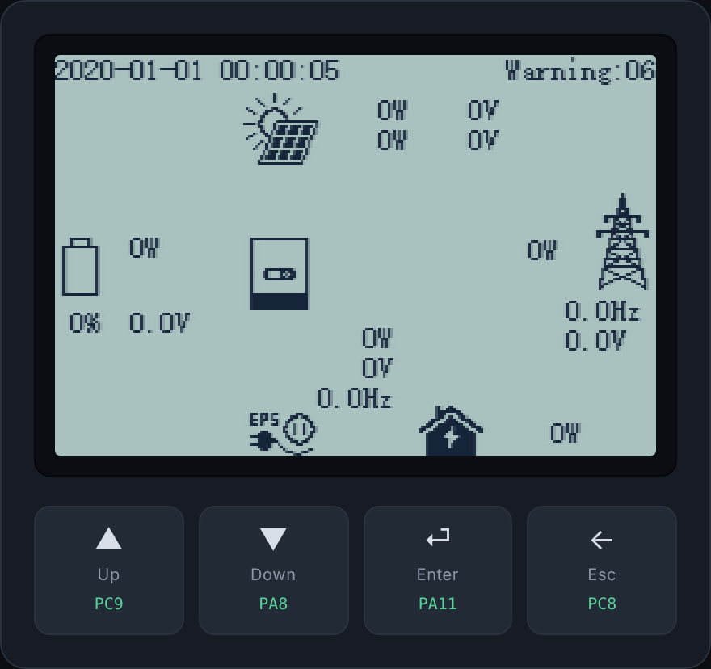
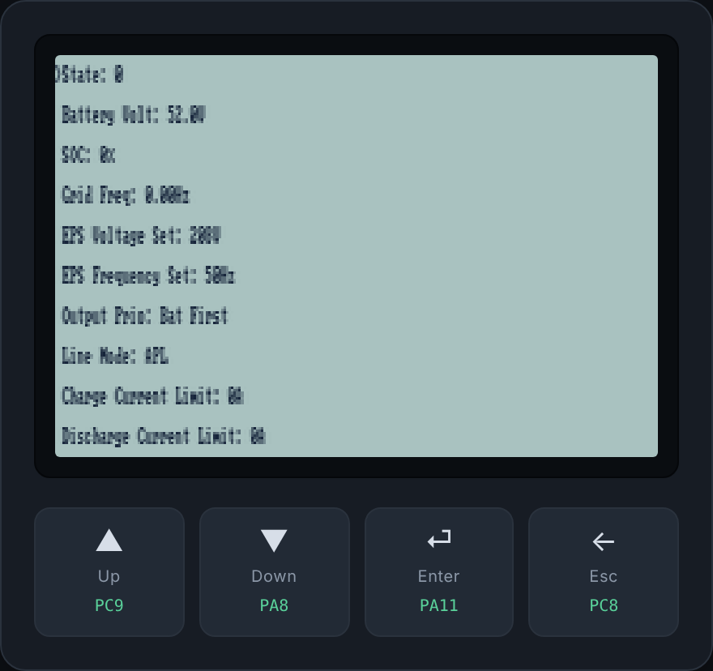

# inverter-com-fw — open-source firmware for EG4 / Luxpower inverters

**Open-source firmware for EG4 / Luxpower all-in-one solar inverters**, focused on
the ARM **"com" MCU** — the communications / HMI / supervisor processor. It is a
clean-room, C-language reimplementation built from reverse-engineering the factory
images, with the original binary used as a behavioural **oracle** (never copied).

Effort is concentrated on the **EG4 12000XP** today, with the near-term goal of
extending to the related inverters that run the *same* com-MCU codebase — the
**EG4 18kPV** and **EG4 6000XP** (they differ only in a short, enumerable set of
ways, captured as a build-time **variant descriptor**, `include/inv/variant.h`).

> ## ⚠️ EXPERIMENTAL — DO NOT FLASH ONTO HARDWARE ⚠️
>
> This project is **early-stage and experimental**. It is a research /
> reverse-engineering effort, **not** a finished firmware. **Do not flash it onto
> a physical inverter** — it is not feature-complete, not safety-reviewed, and not
> hardware-tested. Running it on real power-conversion hardware could destroy the
> unit and is dangerous. For now it lives entirely in the emulator and host tests.
> See the [disclaimer of all warranties](#license) below. 🧪🔬

## See it run: the real HMI, in the emulator

Both images below are the firmware's **own display code** executing under our
Unicorn harness (`tools/arm_sim.py`) — every pixel is drawn by the firmware, and
the four buttons press the real front-panel key GPIOs. Try it yourself with
`make factory-hmi` / `make hmi-sim`.

| Factory firmware (the real EG4 image) | Our open-source firmware |
|:---:|:---:|
|  |  |
| **Actual EG4 inverter code**, booted in the emulator, painting its live overview screen (PV / battery / grid / EPS). | **Our firmware** booting its own HMI — the recovered menu engine rendering on the same panel. |

## What this is (and isn't)

An EG4 all-in-one inverter contains **several processors**, and the vendor ships
separate firmware for each role (`com` / `dsp` / `mppt`):

- an ARM **"com" MCU** (STM32F103VE-class) — comms, HMI, supervisor, relays — **this is what we reimplement**;
- a TI C2000 **control DSP** — the real-time power electronics (measures PV/grid, runs the inverter FSM);
- a **redundant / "safety" CPU** that cross-checks the DSP and gates the inverter;
- a dedicated **`mppt` power-stage controller** (a smaller STM32G0-class part).

**We reimplement only the ARM "com" MCU.** The DSP that runs the real-time power
electronics is intentionally left untouched — our firmware talks *to* it over the
existing link, reproducing that protocol exactly.

## System block diagram

Six processors have been identified: four on the inverter main/power boards, the
BMS in the battery pack, and the external datalogger dongle. (Per-link detail —
ports, pins, framing — lives in [`docs/wiring/`](docs/wiring/README.md).)

```
                             +------------------------------+
                             |  EG4 datalogger / cloud      |
                             |  "dongle"  ESP32-C3 (ext.)   |   master of the
                             +---------------+--------------+   external RS-485 bus
                                             | UART5  PC12/PD2            [✔]
                                             | 9600 RS-485 (DE PA15)
   battery pack(s)                           | EG4 Modbus (LE + 10-byte SN)
  +---------------------+  CAN1  PB8/PB9      | ARM = slave
  | BMS  HC32F460       |<------------------->|
  | (ARM-CAN1)          |  classic 11-bit CAN |
  +--------+------------+  0x3xx up / 0x30x dn |
           | RS-485 pack-to-pack              |
           : (daisy chain)                    v
  meter? ----- UART4 PC10/PC11 ------>+--------------------------------------------+
  (open [?])   2400 RS-485 (DE PA15)  |   ARM "com" MCU  (STM32F103VE-class)       |
  console? --- USART1 PA9/PA10 ------>|   comms . HMI . supervisor . relays        |
  (off this boot [?])                 |   << THIS PROJECT >>  no analog metering   |
                                      +--+-----------------------------------+--+--+
                 USART3 PB10/PB11        |                                   |  |
                 19200 TTL   [✔]         |                       SPI1 PA5/6/7|  | GPIOB PB12-15
                 ARM->DSP config (0x41)  |                       +CS PA4  [✔]|  | bit-banged [✔]
                 +bootloader 21/22/23    |                            |      |  |
                 DSP->ARM telem (0x49)   | (= DSP SCI-B)              v      |  v
                                         v                     +-----------+ | +------------------+
                                  +--------------------------+  | config    | | | graphic LCD      |
                                  |  TI C2000 Control DSP    |  | NOR flash | | | 240x160 mono     |
                                  |  (F2837x) real-time FSM  |  | (ARM-SPI1)| | | MIPI-DCS, 1bpp   |
                                  |  measures PV & grid      |  +-----------+ | | (ARM-LCD)        |
                                  +--+-------------------+---+                | +------------------+
                MPPT USART1 0x42      | DSP = master  [~]|  SCI-C 9600 TTL     |
                big-endian Modbus [✔] v  of both links   |  'T'/'D'   [✔ DSP]  v
                (peer=DSP, [~])    +------------------+   |  cross-check  +------------------------+
                                   | MPPT controller  |   |               | redundant / safety CPU |
                                   | CBAA, STM32G0    |   +-------------->| (part unknown)         |
                                   | (MPPT-USART1)    |      SCI-A 9600   | votes + gates inverter |
                                   | PV V/I/P telem   |      bulk dump    | (DSP-SCI-C)            |
                                   +------------------+      (DSP-SCI-A)  +-----------+------------+
                                                                                     | USART2 PA2/PA3
                                                                                     | 19200 RS-485
                                                                                     | (DE PC2), RX-only [✔]
                                                                                     | safety CPU -> ARM:
                                                                                     | mode + its own grid/PV
                                                                                     | measurements + fault (E027)
                                                                                     v  (ARM-USART2)
                                                                            (to ARM USART2, above)
```

## Goals & approach

We treat the factory binary as a **specification oracle**, not source to copy, and
work in two phases:

1. **Be a faithful drop-in replacement first.** Match the factory firmware's
   observable behaviour exactly, proven by an **oracle-first** test harness: one
   Unicorn emulator runs *both* the factory image and ours against the **same**
   black-box tests (GPIO, relays, HMI, Modbus, the ARM↔DSP config push), so "ours
   agrees with the factory" is a passing test, not a hope. Output is
   *functionally* equivalent, not byte-identical (they built with Keil armcc; we
   use GCC) — byte-matching is an explicit non-goal.
2. **Then go beyond the factory.** Once parity holds, add the things an open
   firmware can do better — richer Home-Assistant telemetry, standard-Modbus
   framing, lease-based remote controls, and more. Those ideas are collected in
   [`docs/38-oss-feature-ideas.md`](docs/38-oss-feature-ideas.md).

Anything the factory does that looks wrong or surprising is written down — with a
verdict on whether we replicate or fix it — in the factory-quirks log
[`docs/31-factory-quirks.md`](docs/31-factory-quirks.md).

**Active work is tracked as specific, claimable tasks on the parity roadmap
[`docs/39-parity-roadmap.md`](docs/39-parity-roadmap.md)** — start there. The
historical bootstrapping milestone log is archived in
[`docs/progress-archive.md`](docs/progress-archive.md).

This is a substantial, multi-contributor effort — expect it measured in months,
not days. The binary is readable, but the *meaning* of its numbers (enum values,
scaling, storage layout, and especially the DSP protocol) must be recovered piece
by piece. The repo is structured so that work parallelizes and accumulates.

## Building & running

```bash
make                 # EG4 12000XP (monolithic image, vectors @0x08000000)
make VARIANT=18kpv   # EG4 18kPV   (App over a bootloader, vectors @0x0800C800)
make VARIANT=6000xp  # EG4 6000XP  (App over a bootloader, vectors @0x08005000)
make test            # host-side unit tests (no hardware)
make test-sim        # GPIO / HMI behaviour tests on the Unicorn harness
make hmi-sim         # graphic-HMI simulator for our build (FIRMWARE=App.hex for a vendor image)
make factory-hmi     # the simulator on the factory image specifically (docs/28)
make factory-coverage # how much of the factory binary our parity tests exercise (docs/42)
```

`make hmi-sim` / `make factory-hmi` boot the firmware in the emulator and serve its
graphic LCD plus the four front-panel keys at `http://localhost:8090/`
(`HMI_PORT=…` to change) — this is how the screenshots above were produced. Needs
`pip install unicorn` (+ `numpy`, `pillow` for the HMI app). Building needs
`gcc-arm-none-eabi`; host tests need a host `cc`.

Today the firmware boots, runs the 72 MHz clock init and a 1 ms SysTick, drives
the graphic HMI, and services a Modbus-RTU slave against a shared register model —
the foundation the remaining subsystems grow into, **not yet a functional
replacement**. Flashing helpers (ST-Link / OpenOCD) are commented in the
`Makefile`, but see the experimental warning above: **don't**.

## Repository layout

```
docs/        analysis + recovered specification (start here)
docs/wiring/ per-link wiring source-of-truth (ports, pins, peers, framing)
docs/39-…    the parity task board (claim work here)
include/inv/ recovered data model (states, faults, settings, modbus_map, hmi_menu, variant)
src/         firmware: startup, main, modbus/, uart/, can/, hmi/, dsp/, relay, …
ldscripts/   per-variant linker scripts
tests/       host unit tests (make test) + the Unicorn sim contracts
tools/       RE scripts (read-only) + the Unicorn emulator & on-screen HMI app
reference/   original .bin (gitignored) + generated RE outputs; see reference/README.md
Makefile     build -> flashable .bin ; make test
```

## The original binaries are not committed

The proprietary factory images are **not** part of this repository — contributors
place their own copy under `reference/` (gitignored). The committed, canonical
reference image and the 05↔07 address convention are documented in
[`reference/README.md`](reference/README.md); image hashes for integrity are
recorded there.

## Contributing

Claim a task on the [parity roadmap](docs/39-parity-roadmap.md), or pick an
"unknown" row in [`docs/02-recovered-model.md`](docs/02-recovered-model.md). The
most valuable contributions right now are (a) the exact MCU part number, (b)
further decode of the ARM↔DSP protocol, and (c) a config dump + Modbus map from a
real unit.

## License

**GNU GPL v3.0** — see [`LICENSE`](LICENSE). Contributions are accepted under the
same license.

THE SOFTWARE IS PROVIDED "AS IS", WITHOUT WARRANTY OF ANY KIND, EXPRESS OR
IMPLIED. It is experimental and **not intended to be flashed onto physical
hardware**; the authors accept no liability for any damage, loss, or injury
arising from its use. You assume all risk.
